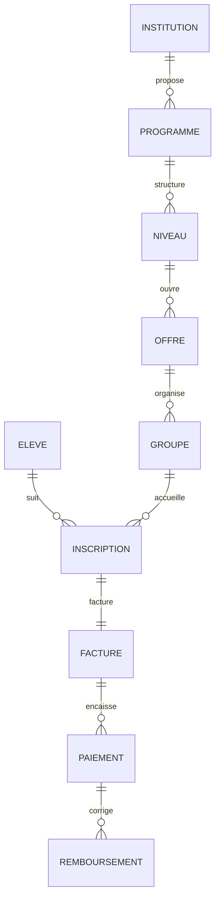

# Schéma de données

33 tables PostgreSQL, regroupées dans le schéma `school`. `public.users` appartient au projet Laravel existant et n’est pas recréée ici. Les identités métier utilisent UUID ; toutes les tables métiers portent `tenant_id`. Les montants sont en centimes de DZD (`bigint`). Les dates d’événements utilisent `timestamptz`.

## Relations principales



## Domaines

| Domaine | Tables |
|---|---|
| Isolation | institutions, memberships |
| Catalogue | campuses, periods, programs, levels, subjects, curriculum, offerings, cohorts, rooms |
| Personnes | students, guardians, student_guardians, staff |
| Scolarité et formation | enrollments, sessions, attendance, lesson_versions, assessments, grades |
| Finance | invoices, payments, refunds, expenses, disbursements |
| Ressources humaines | contracts, work_logs, payroll_runs |
| Infrastructure métier | documents, announcements, outbox, audit_events |

`invoice_balances` est une vue avec les droits de son appelant : montant facturé, montant net encaissé et reste à régler. Les états financiers ne sont pas stockés dans l’inscription.

`documents` est une structure de métadonnées sans endpoint de téléversement dans cette version. Les tables de catalogue sont accessibles en création/lecture ; aucun changement destructif générique n’est exposé.

Le catalogue d’exemple `database/schema/example-catalog.sql` configure des cycles et des formations. L’exécuter une seule fois sur un établissement vide ; ses libellés sont adaptables, sans prétention de nomenclature réglementaire complète.

## Dictionnaire exact

Les blocs ci-dessous sont extraits du SQL livré. Pour les index, RLS, fonctions et déclencheurs, consulter `001_school.sql`.

### `institutions`

```sql
id uuid PRIMARY KEY DEFAULT gen_random_uuid(), name text NOT NULL,
 kind text NOT NULL CHECK(kind IN ('school','training','mixed')),
 timezone text NOT NULL DEFAULT 'Africa/Algiers' CHECK(timezone='Africa/Algiers'),
 currency char(3) NOT NULL DEFAULT 'DZD' CHECK(currency='DZD'),
 settings jsonb NOT NULL DEFAULT '{}', created_at timestamptz NOT NULL DEFAULT now()
```

### `memberships`

```sql
tenant_id uuid NOT NULL REFERENCES school.institutions(id),
 user_id bigint NOT NULL REFERENCES public.users(id),
 permissions jsonb NOT NULL DEFAULT '[]' CHECK(jsonb_typeof(permissions)='array'),
 active boolean NOT NULL DEFAULT true, PRIMARY KEY(tenant_id,user_id)
```

### `campuses`

```sql
id uuid PRIMARY KEY DEFAULT gen_random_uuid(),
 tenant_id uuid NOT NULL REFERENCES school.institutions(id),
 name text NOT NULL,
 wilaya_code varchar(2),
 address text,
 UNIQUE(tenant_id,name),
 created_at timestamptz NOT NULL DEFAULT now(),
 UNIQUE(tenant_id,id)
```

### `periods`

```sql
id uuid PRIMARY KEY DEFAULT gen_random_uuid(),
 tenant_id uuid NOT NULL REFERENCES school.institutions(id),
 name text NOT NULL,
 starts_on date NOT NULL,
 ends_on date NOT NULL,
 CHECK(ends_on>=starts_on),
 UNIQUE(tenant_id,name),
 created_at timestamptz NOT NULL DEFAULT now(),
 UNIQUE(tenant_id,id)
```

### `programs`

```sql
id uuid PRIMARY KEY DEFAULT gen_random_uuid(),
 tenant_id uuid NOT NULL REFERENCES school.institutions(id),
 code varchar(40) NOT NULL,
 name text NOT NULL,
 kind text NOT NULL CHECK(kind IN ('school','vocational','language','short_course','other')),
 description text,
 active boolean NOT NULL DEFAULT true,
 UNIQUE(tenant_id,code),
 created_at timestamptz NOT NULL DEFAULT now(),
 UNIQUE(tenant_id,id)
```

### `levels`

```sql
id uuid PRIMARY KEY DEFAULT gen_random_uuid(),
 tenant_id uuid NOT NULL REFERENCES school.institutions(id),
 program_id uuid NOT NULL,
 code text NOT NULL,
 name text NOT NULL,
 position smallint NOT NULL DEFAULT 0,
 UNIQUE(tenant_id,program_id,code),
 created_at timestamptz NOT NULL DEFAULT now(),
 UNIQUE(tenant_id,id),
 FOREIGN KEY(tenant_id,program_id) REFERENCES school.programs(tenant_id,id)
```

### `subjects`

```sql
id uuid PRIMARY KEY DEFAULT gen_random_uuid(),
 tenant_id uuid NOT NULL REFERENCES school.institutions(id),
 code text NOT NULL,
 name text NOT NULL,
 UNIQUE(tenant_id,code),
 created_at timestamptz NOT NULL DEFAULT now(),
 UNIQUE(tenant_id,id)
```

### `curriculum`

```sql
id uuid PRIMARY KEY DEFAULT gen_random_uuid(),
 tenant_id uuid NOT NULL REFERENCES school.institutions(id),
 level_id uuid NOT NULL,
 subject_id uuid NOT NULL,
 hours numeric(8,2) CHECK(hours>=0),
 coefficient numeric(6,2) NOT NULL DEFAULT 1 CHECK(coefficient>0),
 UNIQUE(tenant_id,level_id,subject_id),
 created_at timestamptz NOT NULL DEFAULT now(),
 UNIQUE(tenant_id,id),
 FOREIGN KEY(tenant_id,level_id) REFERENCES school.levels(tenant_id,id),
 FOREIGN KEY(tenant_id,subject_id) REFERENCES school.subjects(tenant_id,id)
```

### `offerings`

```sql
id uuid PRIMARY KEY DEFAULT gen_random_uuid(),
 tenant_id uuid NOT NULL REFERENCES school.institutions(id),
 level_id uuid NOT NULL,
 period_id uuid NOT NULL,
 campus_id uuid NOT NULL,
 name text NOT NULL,
 price_minor bigint NOT NULL CHECK(price_minor>=0),
 active boolean NOT NULL DEFAULT true,
 created_at timestamptz NOT NULL DEFAULT now(),
 UNIQUE(tenant_id,id),
 FOREIGN KEY(tenant_id,level_id) REFERENCES school.levels(tenant_id,id),
 FOREIGN KEY(tenant_id,period_id) REFERENCES school.periods(tenant_id,id),
 FOREIGN KEY(tenant_id,campus_id) REFERENCES school.campuses(tenant_id,id)
```

### `students`

```sql
id uuid PRIMARY KEY DEFAULT gen_random_uuid(),
 tenant_id uuid NOT NULL REFERENCES school.institutions(id),
 matricule varchar(40) NOT NULL,
 first_name text NOT NULL,
 last_name text NOT NULL,
 birth_date date,
 phone varchar(30),
 email text,
 user_id bigint REFERENCES public.users(id),
 active boolean NOT NULL DEFAULT true,
 UNIQUE(tenant_id,matricule),
 UNIQUE(tenant_id,user_id),
 created_at timestamptz NOT NULL DEFAULT now(),
 UNIQUE(tenant_id,id)
```

### `guardians`

```sql
id uuid PRIMARY KEY DEFAULT gen_random_uuid(),
 tenant_id uuid NOT NULL REFERENCES school.institutions(id),
 name text NOT NULL,
 phone varchar(30),
 email text,
 created_at timestamptz NOT NULL DEFAULT now(),
 UNIQUE(tenant_id,id)
```

### `student_guardians`

```sql
id uuid PRIMARY KEY DEFAULT gen_random_uuid(),
 tenant_id uuid NOT NULL REFERENCES school.institutions(id),
 student_id uuid NOT NULL,
 guardian_id uuid NOT NULL,
 relationship text NOT NULL DEFAULT 'parent',
 can_collect boolean NOT NULL DEFAULT false,
 UNIQUE(tenant_id,student_id,guardian_id),
 created_at timestamptz NOT NULL DEFAULT now(),
 UNIQUE(tenant_id,id),
 FOREIGN KEY(tenant_id,student_id) REFERENCES school.students(tenant_id,id),
 FOREIGN KEY(tenant_id,guardian_id) REFERENCES school.guardians(tenant_id,id)
```

### `staff`

```sql
id uuid PRIMARY KEY DEFAULT gen_random_uuid(),
 tenant_id uuid NOT NULL REFERENCES school.institutions(id),
 code text NOT NULL,
 name text NOT NULL,
 user_id bigint REFERENCES public.users(id),
 is_teacher boolean NOT NULL DEFAULT false,
 active boolean NOT NULL DEFAULT true,
 UNIQUE(tenant_id,code),
 UNIQUE(tenant_id,user_id),
 created_at timestamptz NOT NULL DEFAULT now(),
 UNIQUE(tenant_id,id)
```

### `rooms`

```sql
id uuid PRIMARY KEY DEFAULT gen_random_uuid(),
 tenant_id uuid NOT NULL REFERENCES school.institutions(id),
 campus_id uuid NOT NULL,
 name text NOT NULL,
 capacity integer NOT NULL CHECK(capacity>0),
 UNIQUE(tenant_id,campus_id,name),
 created_at timestamptz NOT NULL DEFAULT now(),
 UNIQUE(tenant_id,id),
 FOREIGN KEY(tenant_id,campus_id) REFERENCES school.campuses(tenant_id,id)
```

### `cohorts`

```sql
id uuid PRIMARY KEY DEFAULT gen_random_uuid(),
 tenant_id uuid NOT NULL REFERENCES school.institutions(id),
 offering_id uuid NOT NULL,
 name text NOT NULL,
 capacity integer NOT NULL CHECK(capacity>0),
 UNIQUE(tenant_id,offering_id,name),
 UNIQUE(tenant_id,id,offering_id),
 created_at timestamptz NOT NULL DEFAULT now(),
 UNIQUE(tenant_id,id),
 FOREIGN KEY(tenant_id,offering_id) REFERENCES school.offerings(tenant_id,id)
```

### `enrollments`

```sql
id uuid PRIMARY KEY DEFAULT gen_random_uuid(),
 tenant_id uuid NOT NULL REFERENCES school.institutions(id),
 student_id uuid NOT NULL,
 offering_id uuid NOT NULL,
 cohort_id uuid NOT NULL,
 status text NOT NULL DEFAULT 'validated' CHECK(status IN ('pending','validated','suspended','cancelled')),
 price_minor bigint NOT NULL CHECK(price_minor>=0),
 enrolled_on date NOT NULL DEFAULT CURRENT_DATE,
 idempotency_key uuid NOT NULL,
 UNIQUE(tenant_id,idempotency_key),
 created_at timestamptz NOT NULL DEFAULT now(),
 UNIQUE(tenant_id,id),
 FOREIGN KEY(tenant_id,student_id) REFERENCES school.students(tenant_id,id),
 FOREIGN KEY(tenant_id,offering_id) REFERENCES school.offerings(tenant_id,id),
 FOREIGN KEY(tenant_id,cohort_id,offering_id) REFERENCES school.cohorts(tenant_id,id,offering_id)
```

### `invoices`

```sql
id uuid PRIMARY KEY DEFAULT gen_random_uuid(),
 tenant_id uuid NOT NULL REFERENCES school.institutions(id),
 enrollment_id uuid NOT NULL,
 number text NOT NULL,
 amount_minor bigint NOT NULL CHECK(amount_minor>=0),
 due_on date NOT NULL,
 UNIQUE(tenant_id,enrollment_id),
 UNIQUE(tenant_id,number),
 created_at timestamptz NOT NULL DEFAULT now(),
 UNIQUE(tenant_id,id),
 FOREIGN KEY(tenant_id,enrollment_id) REFERENCES school.enrollments(tenant_id,id)
```

### `payments`

```sql
id uuid PRIMARY KEY DEFAULT gen_random_uuid(),
 tenant_id uuid NOT NULL REFERENCES school.institutions(id),
 invoice_id uuid NOT NULL,
 amount_minor bigint NOT NULL CHECK(amount_minor>0),
 method text NOT NULL CHECK(method IN ('cash','bank','ccp','card')),
 reference text,
 received_at timestamptz NOT NULL DEFAULT now(),
 idempotency_key uuid NOT NULL,
 UNIQUE(tenant_id,idempotency_key),
 created_at timestamptz NOT NULL DEFAULT now(),
 UNIQUE(tenant_id,id),
 FOREIGN KEY(tenant_id,invoice_id) REFERENCES school.invoices(tenant_id,id)
```

### `refunds`

```sql
id uuid PRIMARY KEY DEFAULT gen_random_uuid(),
 tenant_id uuid NOT NULL REFERENCES school.institutions(id),
 payment_id uuid NOT NULL,
 amount_minor bigint NOT NULL CHECK(amount_minor>0),
 reason text NOT NULL CHECK(length(trim(reason))>=3),
 idempotency_key uuid NOT NULL,
 UNIQUE(tenant_id,idempotency_key),
 created_at timestamptz NOT NULL DEFAULT now(),
 UNIQUE(tenant_id,id),
 FOREIGN KEY(tenant_id,payment_id) REFERENCES school.payments(tenant_id,id)
```

### `sessions`

```sql
id uuid PRIMARY KEY DEFAULT gen_random_uuid(),
 tenant_id uuid NOT NULL REFERENCES school.institutions(id),
 cohort_id uuid NOT NULL,
 subject_id uuid NOT NULL,
 teacher_id uuid NOT NULL,
 room_id uuid NOT NULL,
 starts_at timestamptz NOT NULL,
 ends_at timestamptz NOT NULL,
 status text NOT NULL DEFAULT 'planned' CHECK(status IN ('planned','published','cancelled')),
 CHECK(ends_at>starts_at),
 created_at timestamptz NOT NULL DEFAULT now(),
 UNIQUE(tenant_id,id),
 FOREIGN KEY(tenant_id,cohort_id) REFERENCES school.cohorts(tenant_id,id),
 FOREIGN KEY(tenant_id,subject_id) REFERENCES school.subjects(tenant_id,id),
 FOREIGN KEY(tenant_id,teacher_id) REFERENCES school.staff(tenant_id,id),
 FOREIGN KEY(tenant_id,room_id) REFERENCES school.rooms(tenant_id,id)
```

### `attendance`

```sql
id uuid PRIMARY KEY DEFAULT gen_random_uuid(),
 tenant_id uuid NOT NULL REFERENCES school.institutions(id),
 session_id uuid NOT NULL,
 enrollment_id uuid NOT NULL,
 status text NOT NULL CHECK(status IN ('present','absent','late','excused')),
 reason text,
 UNIQUE(tenant_id,session_id,enrollment_id),
 created_at timestamptz NOT NULL DEFAULT now(),
 UNIQUE(tenant_id,id),
 FOREIGN KEY(tenant_id,session_id) REFERENCES school.sessions(tenant_id,id),
 FOREIGN KEY(tenant_id,enrollment_id) REFERENCES school.enrollments(tenant_id,id)
```

### `lesson_versions`

```sql
id uuid PRIMARY KEY DEFAULT gen_random_uuid(),
 tenant_id uuid NOT NULL REFERENCES school.institutions(id),
 subject_id uuid NOT NULL,
 title text NOT NULL,
 version integer NOT NULL CHECK(version>0),
 body text NOT NULL,
 published_at timestamptz,
 UNIQUE(tenant_id,subject_id,title,version),
 created_at timestamptz NOT NULL DEFAULT now(),
 UNIQUE(tenant_id,id),
 FOREIGN KEY(tenant_id,subject_id) REFERENCES school.subjects(tenant_id,id)
```

### `assessments`

```sql
id uuid PRIMARY KEY DEFAULT gen_random_uuid(),
 tenant_id uuid NOT NULL REFERENCES school.institutions(id),
 cohort_id uuid NOT NULL,
 subject_id uuid NOT NULL,
 title text NOT NULL,
 max_score numeric(8,2) NOT NULL DEFAULT 20 CHECK(max_score>0),
 coefficient numeric(6,2) NOT NULL DEFAULT 1 CHECK(coefficient>0),
 held_on date NOT NULL,
 published_at timestamptz,
 created_at timestamptz NOT NULL DEFAULT now(),
 UNIQUE(tenant_id,id),
 FOREIGN KEY(tenant_id,cohort_id) REFERENCES school.cohorts(tenant_id,id),
 FOREIGN KEY(tenant_id,subject_id) REFERENCES school.subjects(tenant_id,id)
```

### `grades`

```sql
id uuid PRIMARY KEY DEFAULT gen_random_uuid(),
 tenant_id uuid NOT NULL REFERENCES school.institutions(id),
 assessment_id uuid NOT NULL,
 enrollment_id uuid NOT NULL,
 score numeric(8,2) CHECK(score>=0),
 status text NOT NULL CHECK(status IN ('marked','absent','exempt','missing')),
 CHECK((status='marked')=(score IS NOT NULL)),
 reason text,
 UNIQUE(tenant_id,assessment_id,enrollment_id),
 created_at timestamptz NOT NULL DEFAULT now(),
 UNIQUE(tenant_id,id),
 FOREIGN KEY(tenant_id,assessment_id) REFERENCES school.assessments(tenant_id,id),
 FOREIGN KEY(tenant_id,enrollment_id) REFERENCES school.enrollments(tenant_id,id)
```

### `contracts`

```sql
id uuid PRIMARY KEY DEFAULT gen_random_uuid(),
 tenant_id uuid NOT NULL REFERENCES school.institutions(id),
 staff_id uuid NOT NULL,
 starts_on date NOT NULL,
 ends_on date,
 basis text NOT NULL CHECK(basis IN ('monthly','hourly')),
 rate_minor bigint NOT NULL CHECK(rate_minor>=0),
 CHECK(ends_on IS NULL OR ends_on>=starts_on),
 created_at timestamptz NOT NULL DEFAULT now(),
 UNIQUE(tenant_id,id),
 FOREIGN KEY(tenant_id,staff_id) REFERENCES school.staff(tenant_id,id)
```

### `work_logs`

```sql
id uuid PRIMARY KEY DEFAULT gen_random_uuid(),
 tenant_id uuid NOT NULL REFERENCES school.institutions(id),
 contract_id uuid NOT NULL,
 worked_on date NOT NULL,
 minutes integer NOT NULL CHECK(minutes>0 AND minutes<=1440),
 validated_at timestamptz,
 UNIQUE(tenant_id,contract_id,worked_on),
 created_at timestamptz NOT NULL DEFAULT now(),
 UNIQUE(tenant_id,id),
 FOREIGN KEY(tenant_id,contract_id) REFERENCES school.contracts(tenant_id,id)
```

### `payroll_runs`

```sql
id uuid PRIMARY KEY DEFAULT gen_random_uuid(),
 tenant_id uuid NOT NULL REFERENCES school.institutions(id),
 staff_id uuid NOT NULL,
 month date NOT NULL CHECK(EXTRACT(DAY FROM month)=1),
 amount_minor bigint NOT NULL CHECK(amount_minor>=0),
 calculation jsonb NOT NULL,
 validated_at timestamptz,
 UNIQUE(tenant_id,staff_id,month),
 created_at timestamptz NOT NULL DEFAULT now(),
 UNIQUE(tenant_id,id),
 FOREIGN KEY(tenant_id,staff_id) REFERENCES school.staff(tenant_id,id)
```

### `expenses`

```sql
id uuid PRIMARY KEY DEFAULT gen_random_uuid(),
 tenant_id uuid NOT NULL REFERENCES school.institutions(id),
 label text NOT NULL,
 amount_minor bigint NOT NULL CHECK(amount_minor>0),
 incurred_on date NOT NULL,
 payroll_id uuid,
 UNIQUE(tenant_id,payroll_id),
 created_at timestamptz NOT NULL DEFAULT now(),
 UNIQUE(tenant_id,id),
 FOREIGN KEY(tenant_id,payroll_id) REFERENCES school.payroll_runs(tenant_id,id)
```

### `disbursements`

```sql
id uuid PRIMARY KEY DEFAULT gen_random_uuid(),
 tenant_id uuid NOT NULL REFERENCES school.institutions(id),
 expense_id uuid NOT NULL,
 amount_minor bigint NOT NULL CHECK(amount_minor>0),
 paid_on date NOT NULL,
 idempotency_key uuid NOT NULL,
 UNIQUE(tenant_id,idempotency_key),
 created_at timestamptz NOT NULL DEFAULT now(),
 UNIQUE(tenant_id,id),
 FOREIGN KEY(tenant_id,expense_id) REFERENCES school.expenses(tenant_id,id)
```

### `documents`

```sql
id uuid PRIMARY KEY DEFAULT gen_random_uuid(),
 tenant_id uuid NOT NULL REFERENCES school.institutions(id),
 student_id uuid,
 storage_key text NOT NULL,
 original_name text NOT NULL,
 mime text NOT NULL,
 size_bytes bigint NOT NULL CHECK(size_bytes>=0),
 sha256 char(64) NOT NULL,
 UNIQUE(tenant_id,storage_key),
 created_at timestamptz NOT NULL DEFAULT now(),
 UNIQUE(tenant_id,id),
 FOREIGN KEY(tenant_id,student_id) REFERENCES school.students(tenant_id,id)
```

### `announcements`

```sql
id uuid PRIMARY KEY DEFAULT gen_random_uuid(),
 tenant_id uuid NOT NULL REFERENCES school.institutions(id),
 title text NOT NULL,
 body text NOT NULL,
 published_at timestamptz,
 created_at timestamptz NOT NULL DEFAULT now(),
 UNIQUE(tenant_id,id)
```

### `outbox`

```sql
id uuid PRIMARY KEY DEFAULT gen_random_uuid(),
 tenant_id uuid NOT NULL REFERENCES school.institutions(id),
 topic text NOT NULL,
 payload jsonb NOT NULL,
 processed_at timestamptz,
 attempts integer NOT NULL DEFAULT 0,
 available_at timestamptz NOT NULL DEFAULT now(),
 created_at timestamptz NOT NULL DEFAULT now(),
 UNIQUE(tenant_id,id)
```

### `audit_events`

```sql
id uuid PRIMARY KEY DEFAULT gen_random_uuid(),
 tenant_id uuid NOT NULL REFERENCES school.institutions(id),
 actor_id bigint REFERENCES public.users(id),
 entity text NOT NULL,
 entity_id uuid NOT NULL,
 action text NOT NULL,
 changed_fields jsonb NOT NULL DEFAULT '[]',
 created_at timestamptz NOT NULL DEFAULT now(),
 UNIQUE(tenant_id,id)
```

