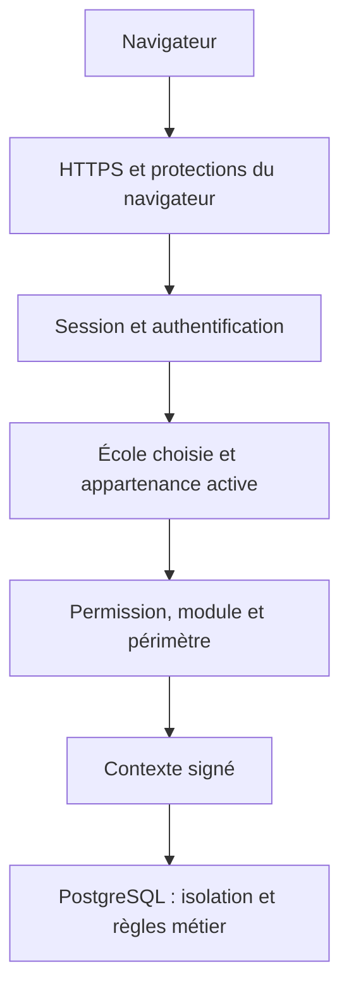

# Analyse de la plateforme Madrassa

Analyse de [README.md](README.md) et de [SECURITY-REVIEW.md](SECURITY-REVIEW.md), portant sur l’état documenté jusqu’à l’incrément 84 du 17 octobre 2026.

Cette analyse porte sur les documents : les tests n’ont pas été exécutés et chaque affirmation n’a pas été vérifiée dans le code.

Ces deux documents décrivent une plateforme de gestion scolaire déjà très étendue, dont le principe central est de faire respecter les règles métier et la sécurité jusque dans PostgreSQL. Le README explique ce qui a été construit et comment cela fonctionne ; la revue de sécurité explique les protections, les failles découvertes et leurs corrections.

## 1. Comment lire le README

Le [README](README.md) présente une nouvelle base appelée **Madrassa**, construite à partir du cahier des charges SRS 1.2. Elle reprend des règles éprouvées des applications `madrassa-backend/` et `ecole-filament/`, qui restent utilisables pendant la transition.

Les références utilisées dans le texte servent à relier chaque développement à une exigence :

| Référence | Signification |
|---|---|
| `FR-…` | Fonctionnalité demandée |
| `NFR-…` | Exigence de sécurité, performance, disponibilité, etc. |
| `BR-…` | Règle métier |
| `AC1`, `AC2`… | Critères permettant d’accepter une fonctionnalité |
| `TST-…` | Scénario de test attendu |
| `OD-…` | Décision ouverte ou à confirmer |
| Incrément | Étape de développement documentée |

Le document va jusqu’à **l’incrément 84**, daté du 17 octobre 2026. Son titre mentionne encore les lots 1–2, alors que son contenu couvre également les lots 3 et 4.

Il doit se lire comme un historique de développement. Cela explique certaines apparentes contradictions : une fonctionnalité indiquée comme « à venir » dans un ancien incrément peut être livrée vingt paragraphes plus loin.

## 2. Architecture générale

L’architecture distingue l’exploitation de la plateforme et la gestion des écoles.

Deux interfaces principales sont décrites :

- `/console` : l’espace de l’éditeur, pour créer les établissements, gérer leurs abonnements, leurs modules et superviser le fonctionnement ;
- `/school` : l’espace des établissements, pour leurs comptes, élèves, inscriptions, finances, employés et plannings.

La pile annoncée comprend PHP 8.3, Laravel 12, PostgreSQL 16 et Filament 5. Livewire permet les interactions des écrans, Redis conserve notamment les sessions et les files de traitement, et un stockage compatible S3 conserve les fichiers.

La plateforme peut héberger plusieurs établissements. Chaque école constitue un **tenant**, c’est-à-dire un espace de données isolé. Une installation dédiée à une seule école est également prévue.

Une distinction essentielle concerne les personnes :

> Une personne possède une identité de connexion commune, mais une appartenance et des droits propres à chaque établissement.

Un enseignant peut donc appartenir à deux écoles sans que celles-ci partagent leurs dossiers ou leurs autorisations.

## 3. Séparation des rôles PostgreSQL

Le tableau des rôles définit quatre responsabilités :

| Rôle | Utilisation | Limitation essentielle |
|---|---|---|
| `school_runtime` | Requêtes des écoles et traitements en arrière-plan | Accès encadré aux données scolaires, sans lecture directe des secrets de connexion |
| `platform_admin` | Console de l’éditeur | Pas de privilèges directs sur le schéma des écoles |
| `platform_auth` | Authentification, mots de passe et MFA | Accès aux informations d’authentification, sans accès aux dossiers scolaires |
| `platform_provisioner` | Propriétaire de fonctions SQL privilégiées | Ne peut pas se connecter directement |

Le propriétaire des migrations dispose de pouvoirs plus élevés, mais ses identifiants doivent rester absents des services web en fonctionnement.

L’intérêt concret est de **limiter les conséquences d’un défaut dans l’application**. Une requête exécutée avec le rôle d’une école ne doit pas pouvoir créer arbitrairement une autre école ou lire les mots de passe de tous les utilisateurs.

`platform_provisioner` intervient à travers des fonctions `SECURITY DEFINER`. Ces fonctions exécutent une opération avec les droits de leur propriétaire. Elles permettent, par exemple, de réaliser une opération contrôlée que l’application ne pourrait pas effectuer directement.

Elles constituent donc un point sensible : leurs droits d’exécution et leurs vérifications internes doivent être rigoureux. La faille F1 montre précisément pourquoi.

## 4. Règles métier dans la base de données

Le principe annoncé est : **écrire l’invariant et son test avant l’écran**.

Un invariant est une règle qui doit rester vraie dans toutes les circonstances, par exemple :

- une classe ne dépasse jamais sa capacité ;
- une école conserve au moins un site actif ;
- une inscription conserve le prix accepté à sa création ;
- une opération financière validée ne peut plus être réécrite ;
- personne ne peut approuver sa propre demande lorsque la séparation des tâches l’interdit.

Les nouvelles tables scolaires doivent porter notamment `tenant_id`, les informations de création et de modification, une `version` et une date d’archivage.

Deux mécanismes méritent une explication.

**Les références composites** telles que `(tenant_id, id)` empêchent de rattacher un enregistrement d’une école à un objet d’une autre école.

**Le verrouillage optimiste**, fondé sur `version`, empêche les modifications concurrentes de s’écraser silencieusement. Si deux secrétaires ouvrent la version 3 d’un dossier et que la première enregistre la version 4, la seconde reçoit un conflit lorsqu’elle tente de sauvegarder son ancienne version.

La base utilise aussi des verrous et des contraintes pour les opérations simultanées. Le document rapporte, par exemple, que trente demandes concurrentes remplissent exactement vingt-cinq places.

## 5. Périmètre fonctionnel

Les incréments peuvent être regroupés ainsi :

| Domaine | Fonctionnalités décrites |
|---|---|
| Administration de la plateforme | Établissements, abonnements, modules, quotas, profils et supervision |
| Comptes et autorisations | Invitations, authentification, MFA, rôles, permissions et périmètres |
| Référentiel | Cycles, niveaux, spécialités, matières, années et périodes |
| Services communs | Journal, fichiers, PDF, notifications, imports, exports et tâches |
| Scolarité | Élèves, responsables, programmes, groupes, inscriptions et progression annuelle |
| Personnel | Dossiers, qualifications, disponibilités, contrats et congés |
| CRM | Prospects, interactions, rappels et conversion en élèves |
| Finance | Échéanciers, encaissements, remboursements, reçus, impayés et clôtures |
| Dépenses et rémunération | Engagements, règlements, corrections, règles de rémunération et paies |
| Planning et présence | Calendrier, séances, conflits, remplacements, publication et pointages |
| Pilotage | Tableau de bord financier |

Quelques choix métier structurent l’ensemble.

Un **dossier d’élève** existe indépendamment d’un compte de connexion. De même, un employé peut être enregistré sans disposer d’accès à l’application.

Un **responsable légal** peut être partagé entre plusieurs enfants. Ses liens avec chaque élève précisent son rôle : contact principal, payeur, contact d’urgence, etc. Un mineur inscrit doit conserver un contact principal joignable par téléphone.

Un **programme** représente une offre pédagogique liée à une année et à un niveau ou une spécialité. Il possède un prix et des conditions. L’inscription en conserve une copie : augmenter le tarif du programme ne modifie donc pas rétroactivement les inscriptions existantes.

Un **groupe** possède une capacité, des membres et éventuellement un enseignant principal et une salle. Les transferts conservent l’historique. Si le groupe cible refuse l’arrivée, le départ du groupe source est annulé avec le reste de la transaction.

Le **CRM** distingue les prospects des élèves. La conversion d’un prospect peut créer le dossier, son responsable et son inscription dans une même transaction : si une étape échoue, l’ensemble est annulé.

Ces choix donnent au produit une continuité entre prospection, admission, scolarité et facturation.

## 6. Permissions et périmètres

L’application doit demander « cette personne peut-elle effectuer cette action ? », plutôt que tester directement un nom de rôle comme `teacher` ou `direction`.

Exemples :

- `student.record.read` : lire les dossiers élèves ;
- `student.record.update` : les modifier ;
- `finance.payment.validate` : valider un paiement.

Mais une permission seule ne suffit pas. Elle s’applique à un **périmètre** : tout l’établissement, certains sites, des niveaux, des groupes, des matières ou les données personnelles, selon le domaine concerné.

Une secrétaire peut ainsi créer et modifier les élèves de son site sans accéder à ceux d’un autre site.

Pour un enseignant, le périmètre personnel peut également ouvrir les groupes qu’il dirige ou dans lesquels il enseigne, pour les permissions effectivement accordées.

Conséquence importante : **le nom du rôle ne garantit pas à lui seul la confidentialité**. Attribuer un rôle d’enseignant avec un périmètre couvrant toute l’école peut lui ouvrir davantage de données. Le bon périmètre fait partie de la configuration de sécurité.

Les contrôles sont réexécutés lors des interactions Livewire. Retirer une permission doit donc prendre effet même lorsqu’une personne garde une page déjà ouverte.

## 7. Finance et séparation des tâches

Les incréments financiers distinguent plusieurs réalités : ce qui est dû, ce qui a été enregistré, ce qui a été validé et ce qui a réellement été payé ou remboursé.

Les montants utilisent `NUMERIC(14,2)` dans PostgreSQL et des chaînes décimales dans l’API. Cela évite les imprécisions liées aux nombres à virgule flottante.

Le fonctionnement décrit est le suivant :

1. L’inscription conserve son prix contractuel.
2. Les remises, abandons de créance et pénalités modifient le montant dû.
3. L’échéancier répartit ce montant en échéances.
4. Un paiement enregistré attend sa validation.
5. Seuls les paiements validés alimentent le montant payé.
6. Une correction ultérieure passe par une opération liée, sans effacer l’original.

L’état pédagogique et l’état financier restent distincts : **payer ne valide pas automatiquement l’inscription sur le plan pédagogique**.

L’accès aux cours dépend d’une politique configurable : aucun paiement exigé, première échéance couverte ou paiement complet.

La séparation des tâches interdit généralement à l’auteur d’une demande de l’approuver. Une exception configurable existe pour la validation de certains paiements ; elle est désactivée par défaut et explicitement tracée.

Les paies suivent également un circuit de calcul puis de validation. Leur versement crée automatiquement la dépense salariale correspondante, dans la même transaction, afin d’éviter les incohérences et les doubles comptages.

Le tableau de bord distingue les recettes, dépenses et paies. Son « résultat de gestion » est défini par sa formule ; le document précise qu’il ne représente ni une position de trésorerie ni un résultat certifié.

## 8. Planning, présences et rémunération

Les derniers incréments décrivent une chaîne cohérente :

> Programme → groupe → séance → pointage validé → heures assurées → paie.

Lors de la planification, la base refuse notamment :

- un enseignant, une salle ou un groupe déjà occupé ;
- un élève engagé simultanément dans deux groupes ;
- un enseignant non qualifié ou indisponible ;
- une salle trop petite ou située sur un autre site ;
- un jour fermé ou une matière étrangère au programme.

D’autres situations produisent un avertissement, comme le dépassement d’un volume prévu ou un déplacement entre sites trop court.

Le planning possède des versions préparées, validées puis publiées. Une version devenue incohérente ou dépassée ne peut pas être publiée sans correction.

Pour les enseignants, seules les présences validées produisent des heures rémunérables. Une séance simplement prévue ne suffit pas. En cas de remplacement, les heures reviennent à la personne qui a assuré le cours.

Pour les élèves, **un appel non effectué ne constitue pas une absence**. Les corrections des marques conservent leur historique.

## 9. Couches de sécurité d’une requête

La [revue de sécurité](SECURITY-REVIEW.md) suit le parcours d’une requête :

Chaque étape apporte une protection différente.

La session utilise des cookies `Secure`, `HttpOnly` et `SameSite=Lax`, ainsi qu’une protection CSRF pour les modifications. Sa durée est limitée par l’inactivité et par une durée absolue de douze heures.

Les mots de passe sont hachés avec Argon2id. La MFA est obligatoire pour les accès privilégiés. Les échecs répétés provoquent une attente progressive, et les codes de récupération sont à usage unique.

L’école active provient de la session serveur, choisie parmi les appartenances autorisées. Le navigateur ne peut pas imposer librement une école en fournissant simplement son identifiant dans une requête.

Enfin, la **Row-Level Security**, ou RLS, filtre les lignes dans PostgreSQL. Elle protège donc aussi contre une requête applicative qui oublierait un filtre d’établissement.

## 10. Contexte signé et correction de F7

À l’origine, PostgreSQL apprenait l’école et l’utilisateur à partir de paramètres de connexion modifiables par le rôle applicatif. Une injection SQL aurait donc pu changer ces paramètres et prétendre agir pour une autre école ou un autre utilisateur.

La correction ajoute une signature HMAC-SHA256 au contexte. Celui-ci contient notamment l’école, l’utilisateur, l’éventuel consentement de support et les informations de requête.

La vérification lie également ce contexte à la connexion PostgreSQL et à la transaction concernées. Un contexte modifié ou repris d’une autre requête doit être refusé.

**La signature garantit l’authenticité du contexte ; elle ne chiffre pas les données.**

La limite reste claire : une injection SQL peut encore agir dans le contexte de la requête compromise, avec les droits disponibles. Cette protection réduit sa portée ; elle ne remplace pas la prévention des injections ni la protection du serveur applicatif et de ses secrets.

Le mécanisme impose aussi une contrainte d’exploitation : le document exclut un pool de connexions en mode transaction entre l’application et PostgreSQL.

## 11. Les huit constats de sécurité

Le registre présente les huit constats comme corrigés, avec une réserve sur le durcissement de la CSP :

| Constat | Problème initial | Correction annoncée |
|---|---|---|
| **F1 — Élevé** | Fonctions SQL exécutables par tous les rôles | Retrait des droits publics et attribution explicite |
| **F2 — Moyen** | Lecture des informations d’authentification de toutes les personnes | Rôle `platform_auth`, puis isolation des identités |
| **F3 — Moyen** | Modification directe des colonnes de mot de passe et de MFA | Écriture réservée au rôle d’authentification |
| **F4 — Moyen** | Absence de politique CSP | CSP ajoutée, avec assouplissements maintenus |
| **F5 — Faible** | Redis sans mot de passe | Authentification et réseau interne |
| **F6 — Faible** | Absence de tests Firefox et WebKit | Ajout des deux moteurs aux tests |
| **F7 — Moyen** | Contexte d’école et d’utilisateur falsifiable par SQL | Contexte signé |
| **F8 — Faible** | Avatars transmis à un service externe | Génération locale des initiales |

F1 était particulièrement sensible : le rôle d’une école pouvait appeler des fonctions réservées à l’éditeur, comme la création ou la suspension d’établissements. Le défaut concernait les privilèges PostgreSQL, même si aucun parcours normal du navigateur ne l’exposait directement.

F2 et F3 concernaient des **hachages de mots de passe et des secrets MFA**, pas une affirmation de stockage des mots de passe en clair. La séparation du rôle d’authentification réduit leur exposition depuis les requêtes scolaires.

F8 correspondait à une transmission des initiales, de l’adresse IP et d’informations de navigateur au service d’avatars. Les images sont désormais produites localement.

## 12. Limites de la Content Security Policy

La Content Security Policy indique au navigateur quelles ressources et quels scripts il peut exécuter. La plateforme utilise notamment un **nonce**, une valeur renouvelée pour autoriser les scripts intégrés légitimes.

Toutefois, le document conserve :

- `'unsafe-eval'` pour les scripts ;
- `'unsafe-inline'` pour les styles.

La suppression de `'unsafe-eval'` a été essayée avec une variante d’Alpine adaptée à une CSP stricte : **104 des 108 variantes d’écran testées échouaient**, en raison du code généré par Filament et Livewire.

Le compromis documenté consiste à conserver cette autorisation tout en empêchant les données utilisateur de devenir du HTML exécutable : échappement des sorties, interdiction du HTML brut et nettoyage des attributs interprétés par Alpine ou Livewire.

L’interprétation de cette analyse est que **F4 est corrigée concernant l’absence de CSP, mais que son durcissement maximal reste dépendant des bibliothèques utilisées**. Les contrôles compensatoires ne permettent pas de déclarer le risque XSS définitivement nul.

## 13. Accès du support

L’établissement accorde un accès motivé, valable au maximum soixante-douze heures et révocable à tout moment.

L’accès aux données sensibles nécessite un consentement distinct. La session reste en lecture seule, sans export ni modification, et ses consultations sont journalisées.

C’est une séparation utile entre les droits d’exploitation de l’éditeur et les droits d’accès aux dossiers des écoles. Elle concerne les rôles et les parcours applicatifs décrits ; elle ne signifie pas que l’administrateur technique de l’infrastructure perd tout pouvoir sur les machines ou les sauvegardes.

## 14. Imports, fichiers et conservation

Les imports disposent d’une prévisualisation qui applique réellement les règles dans une transaction ensuite annulée. Cela permet de détecter les refus de la base avant l’import définitif.

L’application importe ensuite par lots de cent lignes. L’ensemble d’un gros import peut donc être partiellement appliqué avant une erreur ultérieure. Son annulation est une opération distincte, refusée lorsque des modifications ou dépendances apparues depuis empêchent un retour propre.

L’**idempotence** empêche les doublons lorsqu’une demande identique est renvoyée. Elle est utilisée pour les inscriptions, paiements et autres opérations sensibles : plusieurs envois portant la même clé doivent correspondre à une seule opération.

Les fichiers sont contrôlés par leur contenu et leurs droits d’accès. Les liens signés génériques expirent après quinze minutes et permettent une ouverture sans session à qui possède le lien.

Les photos d’élèves suivent des règles plus strictes : contrôle lié au dossier, aucun lien signé générique, reconstruction de l’image sans métadonnées et suppression des anciennes images remplacées.

La conservation prévoit l’archivage puis l’anonymisation de certaines catégories. Les durées sont configurables par école. Le journal peut lui-même être purgé par le traitement de conservation autorisé.

Cela nuance deux formulations générales des documents :

> « Pas de suppression » et « journal immuable » décrivent les opérations ordinaires ; des exceptions encadrées existent pour la conservation, l’annulation d’imports et certaines données de configuration.

## 15. Tests et performance

La dernière validation annoncée comprend :

| Vérification | Dernier résultat documenté |
|---|---|
| Tests PHP d’intégration | 302 tests, 15 524 assertions |
| Vérifications SQL embarquées | 266 |
| Vérifications PostgreSQL 16 avec concurrence | 297 |
| Acceptation locale Chromium | 280 variantes d’écran |

Les vérifications SQL embarquées et natives se recouvrent : il ne faut pas les additionner comme autant de propriétés indépendantes. De même, les « écrans » incluent des variantes de langue et de format ; ce chiffre ne représente pas 280 pages métier distinctes.

La matrice d’accès contient **411 entrées méthode/chemin**. Elle est générée depuis l’application, et un test doit détecter les différences avec sa copie documentaire. C’est un bon mécanisme pour repérer une route oubliée dans la déclaration des permissions. Les tests métier restent nécessaires pour vérifier que la permission choisie est correcte.

Les mesures de performance montrent aussi un travail sur le coût de la sécurité. Une page de matières passe, dans le scénario mesuré, de quatre-vingts secondes à cinq millisecondes. **Ce gain vient de l’optimisation des politiques et des calculs répétés**, pas du fait qu’une signature serait intrinsèquement plus rapide.

## 16. Déploiement, sauvegardes et CI

Le point de validation le plus urgent est la CI bloquée. Les derniers incréments indiquent à plusieurs reprises que GitHub ne pouvait pas démarrer les traitements à cause de la facturation du compte.

Les résultats locaux annoncés restent des preuves utiles, mais les anciens passages sur trois moteurs de navigateur ne valident pas automatiquement les fonctionnalités ajoutées ensuite. Tester WebKit apporte également une couverture du moteur de Safari, sans équivaloir à une validation sur tous les appareils Apple.

Le déploiement prévoit pourtant des contrôles utiles : HTTPS, privilèges restreints, isolation réseau, stockage, tâches planifiées, sauvegarde et restauration.

Les sauvegardes incluent la base, les fichiers et la clé applicative, avec chiffrement et test de restauration dans une installation vierge. Leur efficacité en exploitation dépend ensuite de leur exécution et de leur surveillance réelles.

## 17. Appréciation et travaux restants

L’appréciation est favorable à la conception décrite, avec plusieurs validations encore à terminer.

Les points les plus solides sont l’isolation dans PostgreSQL, les contrôles de concurrence, les historiques financiers, la séparation des tâches et la transformation des constats de sécurité en tests de non-régression.

Le coût de cette approche est une architecture exigeante : les fonctions SQL privilégiées, les politiques RLS, les permissions et les migrations doivent évoluer ensemble.

Les documents identifient encore du travail :

- rétablir la CI et actualiser les validations sur les trois moteurs ;
- faire valider le rapprochement financier prévu pour la sortie du lot 3 ;
- terminer le tableau de bord opérationnel et les exports des tableaux de bord ;
- trancher la liste d’attente des groupes complets ;
- réaliser un test d’intrusion indépendant ;
- traiter les alertes d’activité anormale et la rotation des secrets.

Enfin, les documents gagneraient à présenter un état courant séparé de l’historique : titres actualisés, date de dernière revue, anciens travaux en attente marqués comme résolus, et exceptions aux règles générales regroupées explicitement. Cela rendrait beaucoup plus facile de distinguer **ce qui est livré, ce qui est vérifié récemment et ce qui attend encore une validation**.
